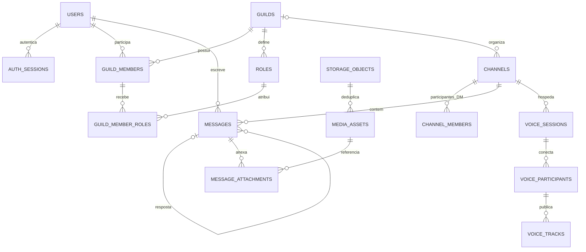

# Tetocord — schema completo proposto

Status: este é o **modelo conceitual das seis fases apresentado antes da implementação**. A implementação foi ampliada por migrações `001` a `006`; a referência executável é `backend/migrations/` e o [schema SQL consolidado](schema.sql), exportado sem dados. Este documento conserva o desenho original e não substitui as restrições/nomenclaturas finais do SQL.

Mapa de evolução: `001` cria a base; `002` acrescenta uploads multipart/anexos; `003` cria catálogos, SFU, temas, amizades/DMs, push e busca; `004` reforça relações de mídia e sessões de voz/webhooks; `005` valida a hierarquia/ciclo de vida dos canais; `006` preserva os nomes digitados de emojis após renomeação. A voz usa identidades de participante por sessão e eventos assinados do LiveKit. Busca usa índice FTS sobre mensagens; deduplicação usa objetos SHA-256 com referências privadas por asset. Veja [validação](validation.md) para o que foi efetivamente exercitado.

## 1. Convenções

- Banco relacional: PostgreSQL 16 ou superior. IDs são `uuid`, gerados pelo backend ou por `gen_random_uuid()`.
- Todas as datas/horas são `timestamptz` em UTC. Fuso de exibição/agendamento fica no perfil, como nome IANA.
- Campos são `NOT NULL`, exceto os marcados com `?`. `PK` indica chave primária, `FK` chave estrangeira e `UQ` unicidade. Campos sem default devem ser fornecidos na criação.
- `created_at` tem default `now()`; `updated_at` começa em `now()` e é atualizado pelo backend nas alterações. Não presumir atualização automática do PostgreSQL.
- `text` armazena texto simples. Mensagens não contêm HTML confiável. Rich text é interpretado por um parser com escape de HTML e validação de URLs.
- Permissões são `bigint` não negativo. Na API, serão strings decimais, convertidas para `BigInt` no TypeScript, evitando perda de precisão de `number`.
- Tamanhos de arquivos são `bigint` em bytes e também trafegam como strings decimais. Sem teto arbitrário de arquivo; capacidade de armazenamento, recursos e protocolo são limites reais.
- Itens de catálogo usam exclusão lógica quando referenciados. Configurações JSON têm versão e validação por schema; não aceitam CSS, JavaScript ou URLs arbitrárias.
- As tabelas são descritas por responsabilidade, não por ordem de criação. FKs cíclicas de perfil/mídia serão adicionadas após as tabelas correspondentes nas migrações.

## 2. Identidade, sessões e preferências

### `users` — Fase 1

| Campo                    | Tipo / regra                                          |
| ------------------------ | ----------------------------------------------------- |
| id                       | uuid PK                                               |
| username                 | varchar(32), 2–32 caracteres; nome de exibição        |
| tag                      | varchar(4), quatro dígitos, de 0001 a 9999            |
| password_hash            | text, hash bcrypt; nunca exposto na API               |
| avatar_asset_id          | uuid? FK media_assets                                 |
| banner_asset_id          | uuid? FK media_assets                                 |
| about_me                 | varchar(1000), default vazio                          |
| preferred_status         | text: online / idle / dnd / invisible; default online |
| custom_status_text       | varchar(128), default vazio                           |
| custom_status_emoji      | varchar(64)?; Unicode padrão na Fase 1                |
| custom_status_expires_at | timestamptz?                                          |
| accent_color             | varchar(7), default #8B5CF6, formato #RRGGBB          |
| created_at, updated_at   | timestamptz                                           |
| disabled_at, deleted_at  | timestamptz?                                          |

UQ em `(lower(username), tag)`. Login usa `username#tag` completo; não requer e-mail ou provedor externo. Registro devolve a tag atribuída. Comparação de senha e mensagens de erro não revelam existência da conta. Senhas bcrypt: validar o limite de 72 bytes UTF-8 e rejeitar excedentes explicitamente, sem truncar.

`preferred_status` é a escolha persistida. Online/offline efetivo é calculado no Redis por conexões ativas; `invisible` aparece como offline para outras pessoas.

### `auth_sessions` — Fase 1

| Campo                    | Tipo / regra                                             |
| ------------------------ | -------------------------------------------------------- |
| id                       | uuid PK; usado como sid no JWT                           |
| user_id                  | uuid FK users                                            |
| family_id                | uuid; agrupa rotações do mesmo login                     |
| refresh_token_hash       | char(64) UQ, SHA-256 de token aleatório de alta entropia |
| replaced_by_session_id   | uuid? FK auth_sessions                                   |
| user_agent               | varchar(512)?                                            |
| created_at, last_used_at | timestamptz                                              |
| expires_at               | timestamptz                                              |
| revoked_at               | timestamptz?                                             |
| revocation_reason        | text?                                                    |

Índices em `(user_id, revoked_at)` e `family_id`. Expiração posterior à criação; uma sessão só tem um sucessor. Rotação atômica com lock de linha. Reutilização revoga toda a família; conservar o registro anterior até expirar para detectar replay. JWT curto, com `sub`, `sid`, `iss`, `aud` e expiração; logout/invalidação também encerra conexões Socket.IO. Refresh fica em cookie HttpOnly/Secure/SameSite; validar origem nas operações com cookies.

### `user_preferences` — Fase 1, ampliada na Fase 5

| Campo            | Tipo / regra                                         |
| ---------------- | ---------------------------------------------------- |
| user_id          | uuid PK FK users                                     |
| theme_mode       | text: dark / light / custom; default dark            |
| theme_id         | uuid? FK themes                                      |
| show_member_list | boolean, default true                                |
| message_density  | text: compact / normal / comfortable; default normal |
| chat_font_size   | smallint, default 16; entre 12 e 28                  |
| locale           | varchar(35), default pt-BR                           |
| timezone         | text, default America/Sao_Paulo; nome IANA válido    |
| updated_at       | timestamptz                                          |

`custom` requer `theme_id`; tema compartilhado só pode ser escolhido se acessível ao usuário. Preferências iniciais criadas junto com o usuário.

### `notification_preferences` — Fase 6

`user_id uuid PK FK users`; `desktop_enabled boolean default false`; `sound_enabled boolean default true`; `direct_messages boolean default true`; `mentions boolean default true`; `everyone_mentions boolean default true`; `quiet_hours_enabled boolean default false`; `updated_at timestamptz`.

### `notification_schedules` — Fase 6

`id uuid PK`; `user_id uuid FK users`; `weekday smallint` (ISO 1–7); `start_local time`; `end_local time`; `created_at timestamptz`.

CHECK `start_local < end_local`; janelas que cruzam meia-noite viram dois registros. UQ `(user_id, weekday, start_local, end_local)`. Sem sobreposição por usuário/dia, validada em transação. Interpretar no fuso do usuário e tratar transições de horário de verão. DND suprime som/push independentemente de agenda; mensagens continuam persistidas.

## 3. Servidores, canais, cargos e acesso

### `guilds` — Fase 1, personalização ampliada na Fase 5

| Campo                          | Tipo / regra                                                  |
| ------------------------------ | ------------------------------------------------------------- |
| id                             | uuid PK                                                       |
| name                           | varchar(100), não vazio                                       |
| owner_id                       | uuid FK users                                                 |
| icon_asset_id, banner_asset_id | uuid? FK media_assets                                         |
| description                    | varchar(1000), default vazio                                  |
| tags                           | text[], default array vazio; até 10 tags de até 32 caracteres |
| boost_enabled                  | boolean, default false                                        |
| boost_level                    | smallint, default 0; 0–3                                      |
| theme_id                       | uuid? FK themes                                               |
| visual_settings                | jsonb, default objeto vazio; versão, cores e opções validadas |
| default_notification_level     | text: all / mentions / none; default mentions                 |
| created_at, updated_at         | timestamptz                                                   |
| deleted_at                     | timestamptz?                                                  |

CHECK: boost desligado implica nível 0; ligado implica nível 1–3. Boost é simbólico, sem cobrança. Ele pode ampliar capacidade/presets, mas não bloqueia quantidade de emojis/figurinhas nem qualidade de stream: esses itens permanecem sem limite artificial. Dono deve ter membership ativo; criação e transferência são transações atômicas. Exclusão/saída do dono exige transferência ou exclusão do servidor.

### `guild_members` — Fase 1

`guild_id uuid FK guilds`; `user_id uuid FK users`; `nickname varchar(32)?`; `joined_at timestamptz default now()`; `timeout_until timestamptz?`; `notification_level text default inherit` (inherit / all / mentions / none). PK `(guild_id, user_id)`. Índice por `user_id`.

Só existem memberships ativos. Saída remove membership e atribuições de cargo, não apaga mensagens. Timeout impede envio, voz e outras ações de participação conforme a política do servidor.

### `roles` — Fase 1

`id uuid PK`; `guild_id uuid FK guilds`; `name varchar(100)`; `color varchar(7)?`; `icon_asset_id uuid? FK media_assets`; `permissions bigint default 0`; `position integer default 0`; `is_everyone boolean default false`; `hoist boolean default false`; `mentionable boolean default false`; `created_at, updated_at timestamptz`.

CHECK permissões e posição não negativas. UQ `(guild_id, id)`; índice `(guild_id, position)`. UQ parcial de `guild_id WHERE is_everyone` garante no máximo um cargo everyone; criação do servidor garante exatamente um. Everyone tem posição 0, não pode ser removido e se aplica implicitamente a todos os membros. Outros cargos têm posição positiva; desempate estável pelo ID. Mudanças de hierarquia são serializadas por servidor.

### `guild_member_roles` — Fase 1

`guild_id uuid`; `user_id uuid`; `role_id uuid`; `assigned_by uuid? FK users`; `assigned_at timestamptz default now()`.

PK `(guild_id, user_id, role_id)`. FKs compostas `(guild_id, user_id) → guild_members` e `(guild_id, role_id) → roles`. Everyone não recebe atribuições explícitas. Índice `(guild_id, role_id)`.

### `channels` — Fase 1, tipos adicionais nas fases seguintes

| Campo                           | Tipo / regra                                                                          |
| ------------------------------- | ------------------------------------------------------------------------------------- |
| id                              | uuid PK                                                                               |
| guild_id                        | uuid? FK guilds; nulo somente para DM/group_dm                                        |
| type                            | text: category / text / voice / video / announcement / forum / thread / dm / group_dm |
| name                            | varchar(100)?; obrigatório em canais de servidor                                      |
| topic                           | varchar(1024), default vazio                                                          |
| parent_id                       | uuid?; categoria pai ou fórum pai de thread                                           |
| created_by                      | uuid FK users                                                                         |
| position                        | integer default 0, não negativo                                                       |
| slowmode_seconds                | integer default 0, não negativo                                                       |
| permissions_synced              | boolean default true; herda sobrescritas da categoria                                 |
| dm_user_low_id, dm_user_high_id | uuid? FK users, apenas para DM de duas pessoas                                        |
| group_owner_id                  | uuid? FK users, apenas group_dm                                                       |
| icon_asset_id                   | uuid? FK media_assets                                                                 |
| archived_at, deleted_at         | timestamptz?                                                                          |
| created_at, updated_at          | timestamptz                                                                           |

UQ `(guild_id, id)`; FK composta `(guild_id, parent_id) → channels(guild_id, id)`. CHECK não ser pai de si mesmo. Pais devem ser do mesmo servidor: category não tem pai; canais comuns só têm category como pai; thread exige forum como pai. Tipo do pai, ausência de ciclos e mudanças de tipo são validados em transação (com constraints/triggers nas migrações para invariantes entre linhas).

CHECK de escopo: canal de servidor requer `guild_id` e nome, com campos de DM nulos. DM/group_dm requer `guild_id` e `parent_id` nulos. DM requer os dois usuários ordenados com `dm_user_low_id < dm_user_high_id`, sem dono de grupo. Group_dm requer dono e não usa o par de DM. UQ parcial do par de usuários para type=dm, incluindo canais arquivados; reabrir reutiliza a conversa. Índice `(guild_id, parent_id, position)`.

Categorias não aceitam mensagens nem participantes de voz. Tipos voice/video mantêm chat associado no mesmo canal; fórum contém threads com mensagens. Na Fase 1 somente category/text ficam disponíveis. Não é necessário criar uma tabela de DM com cópia das mensagens: DM e grupo reutilizam canais e mensagens com autorização própria.

### `channel_members` — Fase 6, apenas DM/group_dm

`channel_id uuid FK channels`; `user_id uuid FK users`; `joined_at timestamptz default now()`; `left_at timestamptz?`; `muted_until timestamptz?`. PK `(channel_id, user_id)`, índice por `user_id`.

DM deve ter exatamente os dois usuários do par; group_dm tem pelo menos dois membros ao criar, com dono ativo. Validar em transação/constraint diferida. `left_at` permite ocultar conversa sem perder o histórico. Após saída de grupo, usuário não recebe novas mensagens nem acessa histórico além da política definida; no MVP de DM, saída revoga todo acesso ao grupo. Leitura de DM individual exige ser um dos dois participantes e não estar bloqueado para novas interações.

### `channel_role_overwrites` — modelo da Fase 1; editor completo na Fase 6

`guild_id uuid`; `channel_id uuid`; `role_id uuid`; `allow bigint default 0`; `deny bigint default 0`; PK `(channel_id, role_id)`.

FKs compostas `(guild_id, channel_id) → channels` e `(guild_id, role_id) → roles`. CHECK `allow >= 0`, `deny >= 0`, `(allow & deny) = 0`.

### `channel_member_overwrites` — modelo da Fase 1; editor completo na Fase 6

`guild_id uuid`; `channel_id uuid`; `user_id uuid`; `allow bigint default 0`; `deny bigint default 0`; PK `(channel_id, user_id)`.

FKs compostas `(guild_id, channel_id) → channels` e `(guild_id, user_id) → guild_members`. Mesmos CHECKs de bits. Sobrescritas só existem em canais de servidor.

### `guild_invites` — Fase 1

`id uuid PK`; `guild_id uuid FK guilds`; `created_by uuid FK users`; `code_hash char(64) UQ`; `max_uses integer?`; `uses integer default 0`; `expires_at timestamptz?`; `revoked_at timestamptz?`; `created_at timestamptz`.

CHECK usos não negativos; `max_uses` positivo se presente; usos não excedem máximo. Token criptograficamente aleatório, exibido na criação; persistir somente hash. Aceite usa lock de linha, revalida banimento/expiração e consome uso apenas ao criar membership novo. Link existente não deve duplicar membro nem consumir uso em retry.

### `guild_bans` — Fase 6

`guild_id uuid FK guilds`; `user_id uuid FK users`; `banned_by uuid? FK users`; `reason varchar(1000)?`; `created_at timestamptz`; `expires_at timestamptz?`; PK `(guild_id, user_id)`. Banir remove membership, encerra assinaturas de canais e revoga participação de voz. Ban ativo impede convites.

## 4. Mensagens, respostas, menções e leitura

### `messages` — Fase 1

| Campo                  | Tipo / regra                                                              |
| ---------------------- | ------------------------------------------------------------------------- |
| id                     | uuid PK                                                                   |
| channel_id             | uuid FK channels                                                          |
| author_id              | uuid FK users                                                             |
| client_nonce           | uuid; idempotência do envio pelo cliente                                  |
| kind                   | text: user / system; default user                                         |
| content                | text, default vazio                                                       |
| version                | bigint, default 1, positivo; incrementado atomicamente em edição/exclusão |
| reply_to_message_id    | uuid?                                                                     |
| mentions_everyone      | boolean, default false                                                    |
| edited_at, deleted_at  | timestamptz?                                                              |
| deleted_by             | uuid? FK users                                                            |
| pinned_at              | timestamptz?                                                              |
| pinned_by              | uuid? FK users                                                            |
| created_at, updated_at | timestamptz                                                               |

UQ `(channel_id, id)`, UQ `(author_id, client_nonce)`; FK `(channel_id, reply_to_message_id) → messages(channel_id, id)` impede reply cruzando canal. CHECK reply diferente do próprio ID. Mensagem deve ter conteúdo não branco, anexo ou figurinha; condição entre tabelas validada por transação/constraint diferida. Fase 1 exige conteúdo não branco, até 4.000 caracteres; limite de texto não é limite de arquivo.

Índice `(channel_id, created_at DESC, id DESC)` para paginação por cursor; índice `(author_id, created_at DESC)`. Busca Fase 6 com GIN em `to_tsvector('simple', content)` somente em mensagens não excluídas, combinada com canal/autor/datas. A busca filtra permissões no banco, não após devolver resultados.

Edição só pelo autor; exclusão pelo autor ou por permissão de moderação. Exclusão lógica limpa o conteúdo e relações de anexos/menções/reações, conserva tombstone para replies e emite evento. `edited_at` só muda quando conteúdo muda. Escritas concorrentes com versão desatualizada recebem conflito, sem sobrescrever silenciosamente edição/exclusão mais recente. Autor moderador fica registrado na auditoria sem copiar conteúdo apagado. Pins exigem permissão; pinned_at/pinned_by devem estar ambos preenchidos ou ambos nulos.

### `message_user_mentions` — Fase 1

`message_id uuid FK messages`; `user_id uuid FK users`; PK `(message_id, user_id)`. Índice `(user_id, message_id)`. Destinatário deve ter acesso ao canal; menções são derivadas no backend, não aceitas como autoridade do cliente.

### `message_role_mentions` — Fase 1

`message_id uuid FK messages`; `guild_id uuid`; `role_id uuid`; PK `(message_id, role_id)`; FK composta `(guild_id, role_id) → roles`. Validar que mensagem e cargo pertencem ao mesmo servidor. DM não aceita cargos. Cargo deve ser mentionable ou autor ter permissão especial. Everyone requer permissão própria; flag não implica autorização.

### `channel_read_states` — Fase 1

`channel_id uuid FK channels`; `user_id uuid FK users`; `last_read_message_id uuid?`; `last_read_at timestamptz?`; `updated_at timestamptz`; PK `(channel_id, user_id)`.

FK `(channel_id, last_read_message_id) → messages(channel_id, id)`; índice por `user_id`. Atualizar marcador de forma monotônica. Leitor precisa de acesso atual ao canal; marcador não concede acesso. Contagens de não lidas são derivadas/cacheadas e menções lidas podem ser marcadas nas notificações.

## 5. Armazenamento, uploads e anexos

### `storage_objects` — Fase 1 para perfil; Fase 2 para arquivos gerais

| Campo         | Tipo / regra                                         |
| ------------- | ---------------------------------------------------- |
| id            | uuid PK                                              |
| sha256        | char(64) UQ, hash calculado/verificado pelo servidor |
| bucket        | text                                                 |
| object_key    | text                                                 |
| size_bytes    | bigint, não negativo                                 |
| detected_mime | text                                                 |
| state         | text: pending / ready / quarantined / deleting       |
| created_at    | timestamptz                                          |
| verified_at   | timestamptz?                                         |

UQ `(bucket, object_key)`. Uma cópia física por hash, com referências lógicas independentes. A aplicação não permite obter URL ou existência de objeto apenas fornecendo hash. Deduplicação ocorre após upload/verificação: não vaza arquivos entre servidores/DMs. Alterações de estado e coleta de lixo usam lock/transação para evitar apagar objeto em reutilização.

### `media_assets` — Fase 1, ampliada na Fase 2

`id uuid PK`; `storage_object_id uuid FK storage_objects`; `owner_id uuid FK users`; `scope text` (profile / guild / channel); `guild_id uuid? FK guilds`; `channel_id uuid? FK channels`; `purpose text` (avatar / banner / guild_icon / guild_banner / role_icon / attachment / emoji / sticker / sound / notification_sound / group_icon); `original_filename text`; `declared_mime text?`; `width integer?`; `height integer?`; `duration_ms bigint?`; `created_at timestamptz`; `deleted_at timestamptz?`.

CHECKs: profile não tem guild/channel; guild exige guild e não tem channel; channel exige channel e não tem guild. Dimensões/duração positivas quando presentes. Índices por `storage_object_id`, `owner_id`, `guild_id` e `channel_id`. Recursos de perfil pertencem ao próprio usuário; ícones/banners de servidor usam escopo guild; anexos usam escopo channel. Cada FK de avatar/banner/ícone/catálogo valida purpose, proprietário e escopo correto.

Buckets são privados. Download exige autorização sobre o uso lógico do asset antes de gerar URL temporária. Acesso a anexo exige mensagem ativa e acesso ao canal. Mídia de perfil exige relação social ou servidor compartilhado; não há catálogo público. `application/octet-stream`, HTML, SVG e executáveis não são renderizados como conteúdo ativo no domínio do app. Forçar download com nome seguro e `Content-Disposition: attachment` quando o tipo não é adequado a preview.

### `upload_sessions` — Fase 1, multipart/reinício na Fase 2

`id uuid PK`; `uploader_id uuid FK users`; `scope text`; `guild_id uuid? FK guilds`; `channel_id uuid? FK channels`; `purpose text`; `filename text`; `declared_mime text?`; `expected_size_bytes bigint?`; `received_size_bytes bigint default 0`; `staging_object_key text UQ`; `multipart_upload_id text?`; `state text` (created / uploading / verifying / complete / failed / aborted); `result_asset_id uuid? FK media_assets`; `created_at timestamptz`; `expires_at timestamptz`; `completed_at timestamptz?`.

Mesmas regras de escopo/purpose de media_assets; tamanhos não negativos. `complete` exige `result_asset_id` e `completed_at`. Índices `(uploader_id, state)` e `(expires_at, state)`. Partes/ETags vêm do multipart do MinIO; não armazenar URLs assinadas. Validar que o objeto completado pertence à sessão e confirmar tamanho/hash real antes de ficar pronto.

Uploads usam streaming ou multipart, sem bufferizar o arquivo inteiro no Node. Rate limit se aplica a iniciar/completar uploads e concorrência, sem impor teto fixo aos bytes de arquivo. Disponibilidade de disco é verificada continuamente. Para mídia de perfil/catálogo há regras de formato e processamento; para anexo qualquer formato pode ser armazenado como download. Extensão e MIME fornecidos pelo cliente não são fonte de confiança. Progresso é do transporte no cliente; download com progresso usa resposta autenticada/URL temporária com CORS apropriado. Falha preserva estado verificável e limpa uploads abandonados.

### `message_attachments` — Fase 2

`id uuid PK`; `message_id uuid FK messages`; `asset_id uuid FK media_assets`; `position smallint default 0`; `description varchar(1000)?`; `created_at timestamptz`.

UQ `(message_id, asset_id)` e `(message_id, position)`; posição não negativa. Asset precisa estar pronto, ter purpose attachment, mesmo channel da mensagem e upload autorizado pelo autor. Arquivos pendentes nunca são publicados. Remover anexo remove a referência lógica; o blob só é coletado quando não houver referências legítimas restantes e após prazo de segurança.

## 6. Emojis, reações, figurinhas e soundboard

### `custom_emojis` — Fase 4

`id uuid PK`; `guild_id uuid FK guilds`; `name varchar(32)` (letras ASCII, números, sublinhado; 2–32); `asset_id uuid FK media_assets`; `created_by uuid FK users`; `animated boolean default false`; `created_at, updated_at timestamptz`; `deleted_at timestamptz?`.

UQ parcial `(guild_id, lower(name))` para ativos. Asset de mesmo guild/purpose emoji. Arquivo GIF/WebP animado permitido; animação detectada no processamento, não confiada ao cliente. Sem limite artificial de quantidade.

### `message_custom_emojis` — Fase 4

`message_id uuid FK messages`; `emoji_id uuid FK custom_emojis`; PK `(message_id, emoji_id)`. Resolve tokens `:nome:` para IDs estáveis no momento do envio e valida escopo do servidor. Renomear emoji não altera identidade; parser pode manter token estruturado com ID. Exclusão torna referência indisponível, sem quebrar mensagem.

### `message_reactions` — Fase 6

`message_id uuid FK messages`; `user_id uuid FK users`; `emoji_key text`; `unicode_emoji text?`; `custom_emoji_id uuid? FK custom_emojis`; `created_at timestamptz`; PK `(message_id, user_id, emoji_key)`.

CHECK exatamente um de Unicode/custom preenchido. Backend normaliza sequência Unicode e calcula chave canônica `u:<sequência>` ou `c:<uuid>`; constraint valida correspondência entre chave e campos. Índice `(message_id, emoji_key)` para contagens. Validar acesso do usuário à mensagem, permissão e guild do emoji. Toggle é idempotente; contagem é derivada. Emoji apagado continua reconhecível como indisponível.

### `custom_stickers` — Fase 4

`id uuid PK`; `guild_id uuid FK guilds`; `name varchar(64)`; `asset_id uuid FK media_assets`; `created_by uuid FK users`; `tags text[] default vazio`; `created_at, updated_at timestamptz`; `deleted_at timestamptz?`.

UQ parcial `(guild_id, lower(name))` para ativos. PNG/WebP/GIF, asset de mesmo guild/purpose sticker. GIN em `tags` para catálogo. Sem limite artificial de quantidade.

### `message_stickers` — Fase 4

`message_id uuid FK messages`; `sticker_id uuid FK custom_stickers`; `position smallint default 0`; PK `(message_id, sticker_id)`; UQ `(message_id, position)`; posição não negativa. Mensagem e sticker do mesmo guild; catálogo/armazenamento persistem identidade para referências históricas.

### `custom_sound_effects` — Fase 4

`id uuid PK`; `guild_id uuid FK guilds`; `name varchar(64)`; `asset_id uuid FK media_assets`; `created_by uuid FK users`; `category varchar(64) default Geral`; `default_shortcut varchar(64)?`; `duration_ms integer` entre 1 e 10.000; `volume real default 1` entre 0 e 2; `created_at, updated_at timestamptz`; `deleted_at timestamptz?`.

UQ parcial `(guild_id, lower(name))` para ativos. Duração detectada no servidor. Asset de mesmo guild/purpose sound. Atalho usa representação validada, sem capturar combinações críticas do navegador. A reprodução exige sessão de voz ativa e permissão; rate limit evita spam.

### `user_soundboard_shortcuts` — Fase 4

`user_id uuid FK users`; `sound_effect_id uuid FK custom_sound_effects`; `shortcut varchar(64)`; PK `(user_id, sound_effect_id)`; UQ `(user_id, shortcut)`. Sobrepõe atalho padrão sem alterar configuração dos outros membros.

### `soundboard_events` — Fase 4

`id uuid PK`; `voice_session_id uuid FK voice_sessions`; `sound_effect_id uuid FK custom_sound_effects`; `triggered_by uuid FK users`; `client_nonce uuid`; `created_at timestamptz`; UQ `(triggered_by, client_nonce)`; índice `(voice_session_id, created_at)`.

Persistir para deduplicação/auditoria curta; não reproduzir eventos históricos ao reconectar. Para todos ouvirem, publicar áudio como trilha pelo SFU com participante de serviço autorizado, respeitando deafen e saída do canal; apenas emitir um evento de interface não garante áudio compartilhado.

GIFs de Tenor/GIPHY usam busca por proxy no backend com chave em variável de ambiente. Ao enviar, importar a mídia selecionada pelo backend como asset e anexá-la; validar destinos, redirects e IPs para impedir SSRF. A mensagem persiste independentemente da disponibilidade futura do provedor. Não é necessária tabela de pesquisa ou de chave de API.

## 7. Voz, vídeo e compartilhamento de tela

### `voice_sessions` — Fase 3

`id uuid PK`; `channel_id uuid FK channels`; `provider_room_name text UQ`; `started_by uuid FK users`; `started_at timestamptz default now()`; `ended_at timestamptz?`.

UQ parcial `channel_id WHERE ended_at IS NULL`. Apenas canais voice/video; validar membro, timeout e permissões antes de emitir token LiveKit curto e restrito à sala. Sala criada no servidor, não por nome arbitrário do cliente.

### `voice_participants` — Fase 3

`id uuid PK`; `voice_session_id uuid FK voice_sessions`; `user_id uuid FK users`; `provider_participant_identity text UQ`; `joined_at timestamptz default now()`; `left_at timestamptz?`; `self_muted boolean default false`; `self_deafened boolean default false`; `server_muted boolean default false`; `server_deafened boolean default false`.

Índices `(voice_session_id, joined_at)` e UQ parcial `user_id WHERE left_at IS NULL` (uma chamada ativa por usuário). Webhooks assinados e eventos SFU atualizam estado, reconciliado em reconexões. Servidor não confia no cliente para mute de moderação. Sessão encerra quando não houver participantes, após tolerância de reconexão.

### `voice_tracks` — Fase 3

`id uuid PK`; `participant_id uuid FK voice_participants`; `provider_track_sid text UQ`; `source text` (microphone / camera / screen_video / screen_audio); `width integer?`; `height integer?`; `fps smallint?`; `started_at timestamptz default now()`; `ended_at timestamptz?`.

Dimensões positivas quando presentes; fps entre 1 e 60. UQ parcial `(participant_id, source) WHERE ended_at IS NULL`. Metadados de faixa descrevem o que foi publicado, não prometem qualidade. Presets de 720p/1080p/1440p/2160p e 15/30/60 fps sem paywall; capacidades do navegador, rede e hardware podem reduzir qualidade.

### `user_voice_preferences` — Fase 3

`user_id uuid FK users`; `target_user_id uuid FK users`; `volume real default 1` entre 0 e 2; `muted_locally boolean default false`; `updated_at timestamptz`; PK `(user_id, target_user_id)`; CHECK usuários distintos. Controle individual afeta apenas reprodução local.

Sinais de fala ativa, níveis de áudio, câmera/tela em andamento e estado atual da sala ficam no LiveKit/Redis. Nenhum SDP, candidato ICE, senha TURN ou token LiveKit é persistido em tabelas. Banco guarda histórico/reconciliação, não um evento por frame de áudio. Fullscreen e seleção de tela/janela/aba são ações do navegador. Áudio do sistema depende de suporte/consentimento do navegador.

SFU LiveKit desde a primeira entrega de chamadas; sem mesh P2P. TURN coturn próprio é obrigatório para conectividade em redes restritivas, além de STUN. Autenticação TURN usa credenciais HMAC temporárias, emitidas pelo backend; segredo compartilhado fica fora do banco e do repositório.

## 8. Temas e sons pessoais

### `themes` — Fase 5

`id uuid PK`; `owner_id uuid FK users`; `guild_id uuid? FK guilds`; `name varchar(64)`; `visibility text default private` (private / guild); `base_mode text` (dark / light); `palette jsonb`; `schema_version smallint default 1`; `created_at, updated_at timestamptz`; `deleted_at timestamptz?`.

Palette exige primary, secondary, background, surface, text e accent em #RRGGBB; demais tokens só se previstos pelo schema. CHECK visibility guild exige guild_id; private exige guild_id nulo. Índice `(guild_id, visibility)`. Compartilhar tema concede leitura aos membros, não permissão de edição. Presets são registros seed imutáveis ou definições versionadas da aplicação, sem usuário fictício obrigatório. Seleção de tema inacessível/excluído usa fallback dark; servidor pode fornecer tema sugerido, sem sobrescrever preferências pessoais.

### `user_notification_sounds` — Fase 5

`user_id uuid FK users`; `event text` (message / call_join / call_leave); `asset_id uuid? FK media_assets`; `enabled boolean default true`; `volume real default 1` entre 0 e 1; PK `(user_id, event)`. Asset de perfil, purpose notification_sound e dono correto. Nulo usa som padrão; enabled=false silencia. Áudio precisa ser validado/decodificado e ter duração razoável para notificação.

## 9. Amizades, DM e notificações

### `friend_requests` — Fase 6

`id uuid PK`; `sender_id uuid FK users`; `recipient_id uuid FK users`; `status text default pending` (pending / accepted / declined / cancelled); `created_at timestamptz`; `responded_at timestamptz?`.

CHECK usuários distintos. UQ parcial do par canônico `(least(sender_id, recipient_id), greatest(sender_id, recipient_id)) WHERE status = pending`. Só destinatário aceita/recusa e só remetente cancela. Aceite cria amizade e atualiza pedido em uma transação. Pedidos cruzados/retries não geram duplicatas. Bloqueio impede novos pedidos.

### `friendships` — Fase 6

`user_low_id uuid FK users`; `user_high_id uuid FK users`; `created_at timestamptz`; PK `(user_low_id, user_high_id)`; CHECK `user_low_id < user_high_id`. Índice adicional em `user_high_id`.

### `user_blocks` — Fase 6

`blocker_id uuid FK users`; `blocked_id uuid FK users`; `created_at timestamptz`; PK `(blocker_id, blocked_id)`; CHECK usuários distintos. Bloqueio remove amizade/cancela pedidos e impede novo DM individual. Em servidor compartilhado não concede poder de expulsão; interface pode ocultar conteúdo do bloqueado sem alterar autorização de moderação.

DM e GroupDM são `channels` com `channel_members`, `messages`, anexos e estados de leitura. Não duplicar modelos de mensagem para cada tipo de conversa.

### `notifications` — Fase 1 para menções; Web Push na Fase 6

`id uuid PK`; `recipient_id uuid FK users`; `actor_id uuid? FK users`; `kind text` (mention / role_mention / everyone_mention / direct_message / friend_request / system); `guild_id uuid? FK guilds`; `channel_id uuid? FK channels`; `message_id uuid? FK messages`; `friend_request_id uuid? FK friend_requests`; `event_key text`; `created_at timestamptz`; `read_at timestamptz?`.

UQ `(recipient_id, event_key)` para retries/fan-out; índice parcial `(recipient_id, created_at DESC) WHERE read_at IS NULL`. Tipos ligados a mensagem exigem message_id/channel_id; friend_request exige pedido. Validar escopo das referências e acesso atual antes de mostrar/entregar. Não persistir texto sensível duplicado no payload de push por padrão. Notificações ligadas a conteúdo excluído não expõem esse conteúdo.

### `push_subscriptions` — Fase 6

`id uuid PK`; `user_id uuid FK users`; `auth_session_id uuid FK auth_sessions`; `endpoint text UQ`; `p256dh text`; `auth_key text`; `created_at timestamptz`; `last_success_at timestamptz?`; `revoked_at timestamptz?`.

Dados de assinatura são privados, não aparecem em listagem pública. Validar endpoint contra provedores de push suportados e bloquear destinos internos/redirects inseguros. Revogar no logout da sessão, remover em 404/410. Chave privada VAPID fica em variável secreta, não na tabela. Web Push depende de HTTPS, permissão do usuário e suporte do navegador.

### `notification_deliveries` — Fase 6

`id uuid PK`; `notification_id uuid FK notifications`; `subscription_id uuid FK push_subscriptions`; `state text default pending` (pending / sent / failed / suppressed); `attempts integer default 0`; `next_attempt_at timestamptz?`; `sent_at timestamptz?`; `last_error_code varchar(64)?`; `created_at timestamptz`.

UQ `(notification_id, subscription_id)`; índice `(state, next_attempt_at)`. Não registrar endpoint/chaves em erro. Jobs reavaliam permissões, bloqueios, DND e agenda antes de enviar; supressão não apaga a notificação interna.

## 10. Auditoria e consistência dos eventos

### `audit_logs` — infraestrutura na Fase 1; interface na Fase 6

`id uuid PK`; `guild_id uuid FK guilds`; `actor_id uuid? FK users`; `action text`; `target_type text`; `target_id uuid?`; `reason varchar(1000)?`; `metadata jsonb default objeto vazio`; `created_at timestamptz`.

Índices `(guild_id, created_at DESC, id DESC)` e `(guild_id, action, created_at DESC)`. Exemplos: guild.update, member.kick, member.ban, role.update, channel.delete, message.moderation_delete, asset.delete. Target é referência histórica polimórfica e deliberadamente não tem FK. Metadados com allowlist, sem senha, token, mensagem apagada ou chave de armazenamento. Append-only por papel de banco; leitura exige VIEW_AUDIT_LOG.

### `outbox_events` — Fase 1

`id uuid PK`; `aggregate_type text`; `aggregate_id uuid`; `aggregate_version bigint?`; `event_type text`; `schema_version smallint default 1`; `payload jsonb`; `created_at timestamptz`; `available_at timestamptz default now()`; `claimed_until timestamptz?`; `attempts integer default 0`; `published_at timestamptz?`; `last_error_code varchar(64)?`.

Índice parcial `(available_at, created_at) WHERE published_at IS NULL`. Mesma transação grava mensagem/mudança e evento; worker reivindica com lock/lease e publica em Socket.IO/Redis após commit. Entrega pelo menos uma vez; consumidores deduplicam pelo ID e versão. Eventos nunca são emitidos como confirmados antes do commit. Redis indisponível não pode perder mensagem já salva; eventos pendentes são retomados.

`aggregate_id` é referência polimórfica sem FK. Payload mínimo, sem credenciais. Workers revalidam acesso na entrega; reconexão reconsulta histórico e membership, não depende de reproduzir tudo do Redis. Eventos de mensagem levam aggregate_version igual à versão persistida, para evitar aplicar evento antigo sobre edição/exclusão mais recente. Outras entidades que exigirem ordenação terão versão monotônica adicionada na respectiva fase; created_at isolado não garante ordem total.

## 11. Permissões bitwise

| Bit | Permissão            | Uso                                         |
| --- | -------------------- | ------------------------------------------- |
| 0   | VIEW_CHANNEL         | Ver canal e receber seus eventos            |
| 1   | READ_MESSAGE_HISTORY | Ler histórico                               |
| 2   | SEND_MESSAGES        | Enviar mensagens                            |
| 3   | MANAGE_MESSAGES      | Excluir mensagens alheias e gerenciar pins  |
| 4   | ATTACH_FILES         | Enviar anexos                               |
| 5   | ADD_REACTIONS        | Reagir                                      |
| 6   | MENTION_EVERYONE     | Mencionar everyone e cargos não mentionable |
| 7   | MANAGE_CHANNELS      | Criar/alterar canais e categorias           |
| 8   | MANAGE_GUILD         | Alterar servidor e boost simbólico          |
| 9   | MANAGE_ROLES         | Gerenciar cargos e sobrescritas             |
| 10  | CREATE_INVITE        | Criar convites                              |
| 11  | KICK_MEMBERS         | Expulsar                                    |
| 12  | BAN_MEMBERS          | Banir                                       |
| 13  | MODERATE_MEMBERS     | Aplicar timeout                             |
| 14  | VIEW_AUDIT_LOG       | Consultar auditoria                         |
| 15  | CONNECT              | Entrar em voz/vídeo                         |
| 16  | SPEAK                | Publicar microfone                          |
| 17  | VIDEO                | Publicar câmera                             |
| 18  | STREAM               | Compartilhar tela e áudio de tela           |
| 19  | MUTE_MEMBERS         | Mute de moderação                           |
| 20  | DEAFEN_MEMBERS       | Deafen de moderação                         |
| 21  | MOVE_MEMBERS         | Mover participantes                         |
| 22  | USE_SOUNDBOARD       | Reproduzir efeitos                          |
| 23  | MANAGE_EXPRESSIONS   | Gerenciar emoji, sticker e som              |
| 24  | CHANGE_NICKNAME      | Alterar próprio apelido                     |
| 25  | MANAGE_NICKNAMES     | Alterar apelido alheio                      |
| 26  | ADMINISTRATOR        | Ignorar sobrescritas de canal               |

Reservar bits restantes até 62; bit 63 não é usado por causa do sinal do bigint. Rejeitar bits desconhecidos em entradas da API. Configuração inicial de everyone concede apenas capacidades básicas, sem administração/moderação.

Resolução em canais de servidor:

1. Exigir usuário ativo e membership; dono tem todas as permissões. Administrator ignora sobrescritas, mas não revoga invariantes de segurança ou regras do dono.
2. Combinar everyone com OR de todos os cargos do membro.
3. Selecionar sobrescritas efetivas: se sincronizado com categoria, usar o conjunto da categoria; se não sincronizado, usar o próprio conjunto. Não aplicar os dois conjuntos cumulativamente. Thread herda do fórum na ausência de conjunto próprio.
4. Aplicar deny/allow de everyone; depois OR de denies e OR de allows de todos os cargos, nessa ordem; por último deny/allow específico do membro. Em cada etapa: `(perms & ~deny) | allow`.
5. Sem VIEW_CHANNEL, negar leitura, eventos e ações do canal. Exigir as permissões específicas de cada ação; timeout impõe restrições adicionais.
6. Gerenciar membro/cargo requer posição superior ao maior cargo do alvo e nunca permite agir contra dono. Um gerente não pode conceder permissões que não tem nem elevar cargo à própria posição ou acima. Atribuição de Administrator exige autorização equivalente.

Membership/overwrites são checados em REST, Socket.IO, busca, upload, download e emissão de token SFU. Rooms Socket.IO não substituem autorização. Alterações revogam assinaturas e credenciais de mídia quando necessário. DMs usam participantes/bloqueios e não cargos de servidor.

## 12. Dados efêmeros no Redis

Redis não substitui PostgreSQL para mensagens, usuários ou refresh tokens.

| Chave lógica                                  | Conteúdo / expiração                                          |
| --------------------------------------------- | ------------------------------------------------------------- |
| presence:user:{id}:sessions                   | Sessões com heartbeat e deadline; ZSET, podar expiradas       |
| presence:session:{sid}                        | Estado da sessão e sockets, TTL 90s, heartbeat a cada 30s     |
| typing:{channelId}:{userId}                   | Indicador de digitação, TTL 8s                                |
| slowmode:{channelId}:{userId}                 | Próximo envio permitido; atualização atômica                  |
| rate:{scope}:{identity}                       | Janela/contador com TTL; login, API, Socket.IO e uploads      |
| voice:room:{sessionId}                        | Cache reconciliável do SFU e participantes, TTL renovado      |
| perm:{guildId}:{userId}:{channelId}:{version} | Cache curto, invalidado ao mudar membership/cargos/overwrites |
| socket-adapter                                | Pub/sub Socket.IO para distribuir eventos entre instâncias    |

Presença agrega várias abas/dispositivos; desconectar uma aba não marca usuário offline se outra sessão está viva. TTL cobre encerramento sem evento de disconnect. Estado DND/idle/invisible vem de users e sinais das sessões; preferência invisível não vaza atividade aos membros. Chaves/cache podem ser recriados após reinício; pendências duráveis permanecem na outbox do PostgreSQL.

## 13. Exclusão, integridade e retenção

- DELETE RESTRICT por padrão em entidades raiz e blobs. Relações puramente dependentes (menções, reações, estados de leitura, atribuições) usam CASCADE ao purgar o pai. Mensagens são tombstones antes de qualquer purge.
- Exclusão de usuário desativa login, revoga sessões/push/voz, exige resolver servidores de que é dono e anonimiza perfil. Preservar ID interno para autoria, com rótulo de conta excluída; limpar senhas, status e assets pessoais. Não usar CASCADE para apagar silenciosamente conversas dos outros.
- Servidores/canais ficam inacessíveis imediatamente quando excluídos; limpeza física é assíncrona e segue retenção configurável. Índices e consultas consideram deleted_at em cada autorização.
- Asset excluído não gera URL nova. URLs assinadas têm prazo curto; blobs partilhados por deduplicação são removidos apenas quando não houver referências ativas. Manter bloqueio/estado de coleta até concluir exclusão no MinIO; falhas são retentáveis.
- Membership deve ser validado em cada escrita sensível; FKs não garantem permissão. Invariantes entre tabelas (mesmo escopo, tipo de pai, dono membro, participantes de DM) serão implementadas com constraints/triggers quando possível e transações com locks na aplicação.
- Índices de FK usados em joins/deleções serão criados explicitamente quando não cobertos por PK/UQ. Paginação por cursor e limites de resposta evitam carregar todo histórico. Não limitar tamanho do arquivo para resolver problemas de paginação.
- Auditoria/outbox/entregas e histórico de voz precisam de política de retenção configurável. Nenhum segredo, token original ou conteúdo de arquivo é registrado em log.

## 14. Relações principais

## 15. Ordem de implementação e critérios

1. **Fase 1:** users, auth_sessions, preferências iniciais, guilds/members/roles, canais category/text, sobrescritas usadas pela autorização, convites, mensagens, menções, leitura, notificações internas, outbox e auditoria básica. MinIO/storage_objects/media_assets/upload_sessions para avatar/banner. Redis para presença/rate limit. Fluxo exigido: dois usuários autenticados, convite aceito, mensagens entre clientes com editar/excluir/reply/menções, reconexão sem perder histórico, acesso negado a não membro e presença coerente com múltiplas abas. Testar rotação/replay/logout de refresh.
2. **Fase 2:** anexos gerais, multipart/progresso, previews seguros e download autorizado, deduplicação e coleta de lixo. Testar arquivo grande sem buffer integral, interrupção, falta de espaço e tentativa de download fora do canal.
3. **Fase 3:** LiveKit + coturn; tabelas de voz e preferências. Testar duas redes reais, incluindo relay TURN forçado, câmera, tela, vários espectadores, mute/deafen, fullscreen e renegociação/reconexão. Não declarar conectividade remota validada só por teste local.
4. **Fase 4:** catálogos/atalhos/soundboard e importação de GIF; validar escopo, autorização administrativa e reprodução pelo SFU.
5. **Fase 5:** editor/presets/compartilhamento de tema, densidade/tamanho de fonte, sons pessoais, personalização de servidor e boost simbólico sem paywall.
6. **Fase 6:** amizades, DM/grupos, bloqueios, reações, busca, push/agendas e interface completa de permissões/auditoria.

As entidades futuras estão descritas agora para evitar redesenho incompatível. Migrações e código serão entregues por fase, e nenhum recurso futuro será apresentado como funcional antes de validação.
